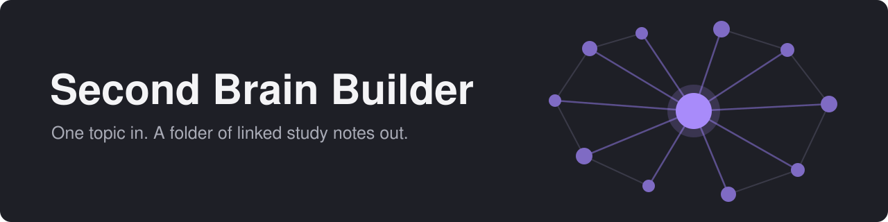
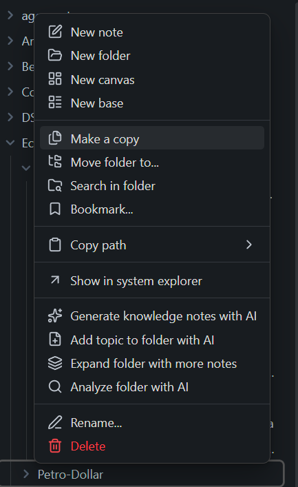
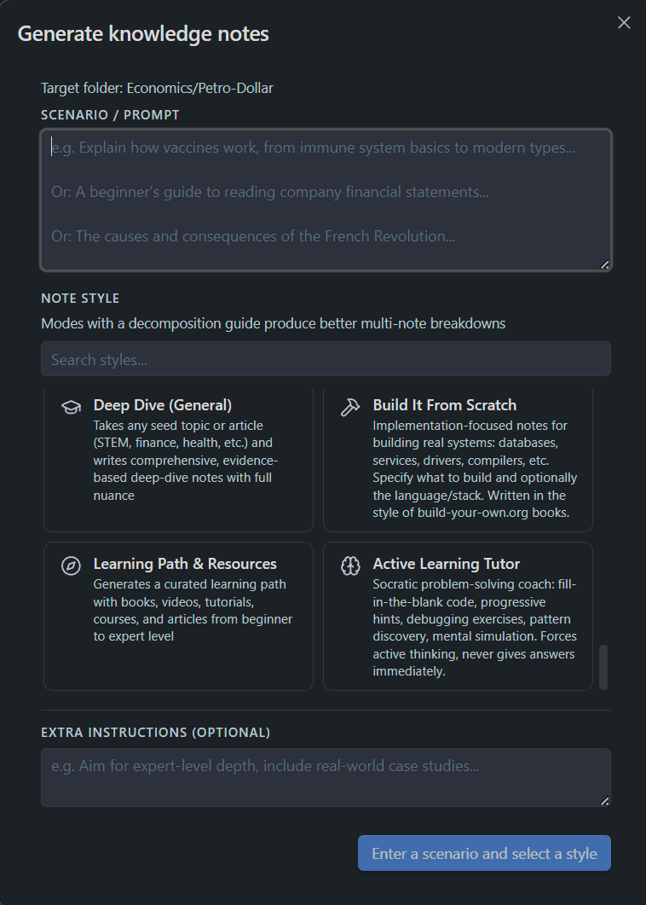
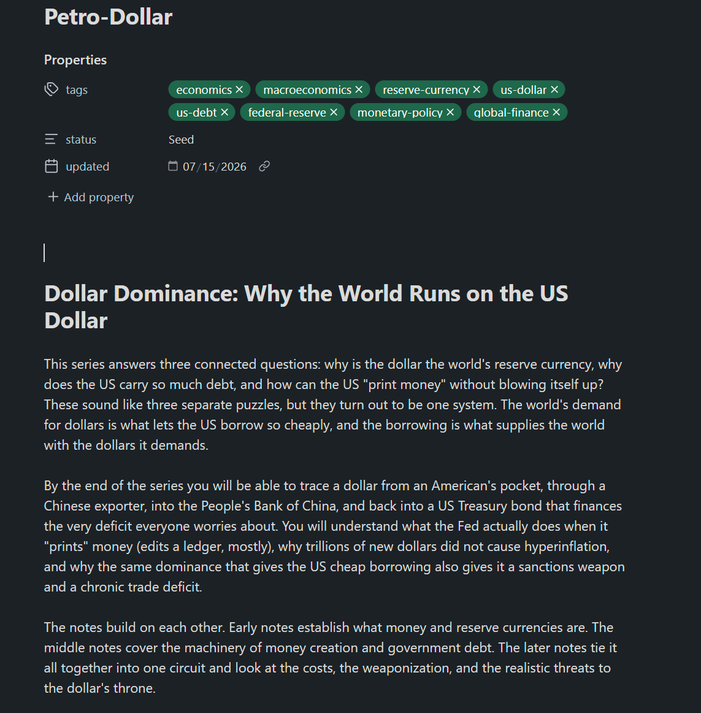
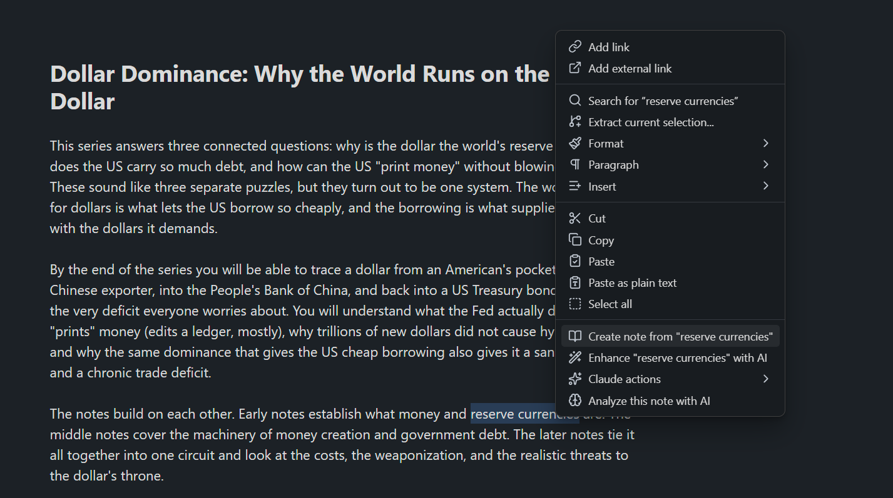
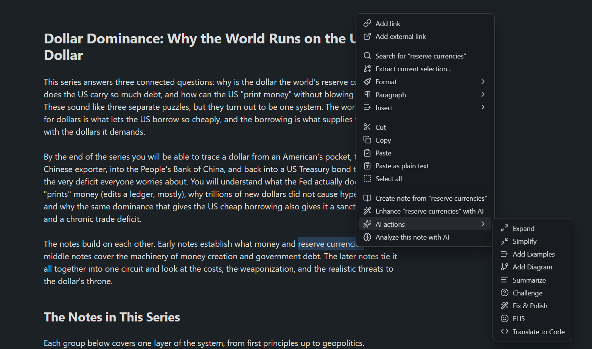

<a id="top"></a>

<p align="center">
  <picture>
    <source media="(prefers-color-scheme: dark)" srcset="assets/banner-dark.svg">
    <source media="(prefers-color-scheme: light)" srcset="assets/banner-light.svg">
    
  </picture>
</p>

<p align="center">
  <a href="#-quick-start"></a>
  <a href="https://github.com/algometrix/second_brain_builder/releases/latest"></a>
</p>

<p align="center">
  <a href="https://github.com/algometrix/second_brain_builder/releases/latest"></a>
  <a href="https://github.com/algometrix/second_brain_builder/releases"></a>
  <a href="LICENSE"></a>
  
  
  <a href="https://github.com/algometrix/second_brain_builder/stargazers"></a>
</p>

<p align="center">
  <a href="#-features"><b>Features</b></a> •
  <a href="#-quick-start"><b>Quick start</b></a> •
  <a href="#-ai-backends"><b>AI backends</b></a> •
  <a href="#-install"><b>Install</b></a> •
  <a href="#-note-modes"><b>Note modes</b></a> •
  <a href="#-troubleshooting"><b>Troubleshooting</b></a> •
  <a href="#-faq"><b>FAQ</b></a> •
  <a href="https://github.com/algometrix/second_brain_builder/issues"><b>Report a bug</b></a>
</p>

<br>

An Obsidian plugin that turns any topic into a folder of interlinked, deep-dive study notes: a generated index hub, mermaid concept maps, and wiki-links that light up the graph view. It also explains selections into linked notes and enhances text in place.

<table>
  <tr>
    <td width="33%" valign="top">
      <h3>📚 A course from one prompt</h3>
      Type a topic. Get an index hub and 8 to 15 linked notes, ordered from foundations to advanced.
    </td>
    <td width="33%" valign="top">
      <h3>💸 No extra AI bills</h3>
      No API keys and no per-token billing. It runs on the Claude, Google, or ChatGPT plan you already have.
    </td>
    <td width="33%" valign="top">
      <h3>🔒 Private when you need it</h3>
      Point it at a local Ollama model. It costs nothing and your notes never leave your computer.
    </td>
  </tr>
</table>

## 🎞 See it in action

One prompt ("why is the dollar the world's reserve currency?") produced this index hub and the 16 linked notes behind it:

<p align="center">
  
  
</p>

## ✨ Features

<table>
  <tr>
    <td width="50%" valign="top">

**🧠 Grow your vault**

- **Whole note series** from a topic, a pasted paragraph, or an article.
- **Index hub** with grouped links, a reading order, and a mermaid map.
- **Cross-linked notes** that form a real cluster in the graph view.
- **Explain a selection** into its own linked note.
- **Sub-notes** that add a deep-dive layer under an existing note.
- **Safe to re-run**: finished notes are skipped and empty stubs get filled.

</td>
    <td width="50%" valign="top">

**🪄 Improve what you have**

- **Nine inline actions**: expand, simplify, add examples, add a diagram, summarize, challenge, fix and polish, ELI5, and translate to code.
- **24 sample note modes**, from Feynman Teacher to Cornell Notes.
- **Your own modes**, added in settings or built from a private file.
- **Study aids**: review questions and fill-in-the-gap exercises.
- **Background queue** with live progress, retry, and remove.
- **Output fixers** that repair the mermaid and callout mistakes LLMs make.

</td>
  </tr>
  <tr>
    <td colspan="2" valign="top">

**🔌 Four AI backends behind one setting**: Claude Code CLI • Gemini CLI • Codex CLI • Ollama

</td>
  </tr>
</table>

### Which command do I want?

| You want to | Run |
|---|---|
| Learn a whole subject from one prompt | [Generate knowledge notes in folder](#generate-knowledge-notes-in-folder) |
| Turn a term in a note into its own linked note | [Explain selection](#explain-selection) |
| Grow a folder of deep-dive notes under the current note | [Create sub-note from selection](#create-sub-notes) |
| Improve text right where it is | [Enhance selection](#enhance-selection) |
| Get review questions or exercises for a finished note | [Analyze current note](#more-commands) |
| Start a subject with no note open | [Generate notes from topic](#more-commands) |
| Fill in empty stub notes you linked earlier | [Fill empty note](#more-commands) |

### Generate Knowledge Notes in Folder

Give the plugin a topic, a pasted paragraph, or a whole article, pick a teaching mode and a target folder, and it builds a complete, interlinked mini-textbook. Run **"Generate knowledge notes in folder with AI"** from the command palette, or right-click a folder.

<p align="center">
  
  
</p>

A few minutes later the folder contains the full series. Each note has YAML frontmatter, tags, and cross-links to its siblings:

<p align="center">
  
</p>

<details>
<summary><b>What happens under the hood</b></summary>
<br>

1. **Planning.** The AI acts as a curriculum designer and decomposes your scenario into 8 to 15 self-contained concept notes, ordered from foundational to advanced. Each planned note gets a title, a defined scope, and a list of related notes in the series. Modes can carry a `folderDecompositionGuide` that teaches the planner how to split topics in that domain, so the breakdown is not generic.
2. **Index hub.** A hub note named after the folder is generated first. It contains an overview of the topic, every note in the series as a `[[wiki-link]]` grouped logically with one-line descriptions, a recommended reading order with rationale, and a **mermaid diagram** (with subgraphs) mapping how the notes relate to each other.
3. **The notes themselves.** Each note is then written in your chosen mode's style, one queue item at a time. Every note receives the full series plan and its own scope, and is instructed to cross-link related notes with `[[wiki-links]]` where relevant. Notes use mermaid diagrams, tables, and Obsidian callouts throughout, and every one gets YAML frontmatter and consistent formatting via the plugin's output rules.
4. **The graph effect.** Because the hub links to every note and the notes link to each other, the folder appears in Obsidian's graph view as a connected cluster around the hub, not a pile of orphan files.
5. **Safe to re-run.** Existing notes with content are skipped and empty stubs are filled in, so you can re-run the command on the same folder to resume an interrupted batch or extend the series.

</details>

### Explain Selection

Select a word or phrase, run **"Explain selection with AI"** (or right-click the selection), and pick one or more modes. The plugin creates a new note in the same folder, writes the AI output into it, and replaces your selection with a `[[wiki-link]]`. If a note with that name already exists, it links to it instead. Select several modes to generate multiple takes on the same topic.

<p align="center">
  
</p>

### Create Sub-Notes

Select text and run **"Create sub-note from selection with AI"**, or right-click and choose **Create sub-note**. For example, select "Kafka, Redis, WebSocket Gateway" in a system design note to generate a linked `Components` folder in one step.

<details>
<summary><b>How topics and links work</b></summary>
<br>

The modal asks for a sub-folder name and a note style, plus a topic list with one note topic per line. If the selection looks like a list ("Kafka, Redis, WebSocket Gateway"), the topics are prefilled from it. If it is prose ("US stopped redeeming dollars for gold"), it stays one line you can rewrite into the topics you want.

On submit, each topic becomes its own note inside the sub-folder under the current note's folder. The generated notes cross-link each other, link back to the parent note, and reuse wiki-links from the surrounding context. Topics taken from the selection replace it with links; rewritten topics keep your text and append the links after it. The sub-folder name is remembered for next time.

</details>

### Enhance Selection

Run **"Enhance selection with AI"** to transform the selected text in place, or insert the result below it. All nine actions are also one right-click away under **AI actions**. Use inline actions to improve the note you are in, and note creation to grow the vault.

<p align="center">
  
</p>

<details>
<summary><b>When to use each action</b></summary>
<br>

| Action | Use it when |
|---|---|
| **Expand** | A passage is too thin and needs more depth, without creating a new note |
| **Simplify** | The text is dense or jargon-heavy |
| **Add Examples** | An abstract explanation needs concrete cases |
| **Add Diagram** | A process or structure would be clearer as a mermaid diagram |
| **Summarize** | A long section needs a TL;DR |
| **Challenge** | You want counterarguments and weaknesses of the claims |
| **Fix & Polish** | Grammar, flow, and clarity need cleanup without changing meaning |
| **ELI5** | You want a beginner-level restatement |
| **Translate to Code** | A described algorithm or process should become working code |

</details>

### More Commands

| Command | What it does | Use it when |
|---|---|---|
| **Analyze current note with AI** | Runs a full-note mode against the entire note and appends the result. The sample modes include Question Generator and Active Recall Prep | You finished a note and want study aids or a critique of the whole thing |
| **Generate notes from topic with AI** | Creates notes from a typed topic with no selection. It can split a broad topic into multiple linked notes | You are starting a new subject from nothing |
| **Fill empty note with AI** | Fills the note you are in, using its title and backlink context as the prompt | You created stub `[[links]]` earlier and want to flesh them out one by one |
| **Insert scale estimation table** | Inserts a back-of-envelope capacity estimation table at the cursor | You keep system design or interview prep notes |
| **Scaffold system design workspace** | Creates a linked workspace of section notes for a design exercise | You are starting a system design exercise |
| **View note generation queue** | Opens a live progress modal with elapsed time, retry, remove, and streaming output (CLI providers; Ollama output appears when generation completes) | You want to watch or manage running jobs |
| **View logs** | Shows recent plugin activity | You are debugging a problem |

All generation runs through a sequential background queue, so you can queue several notes and keep working. The status bar shows the current item and the queue length.

<p align="right"><a href="#top">Back to top ↑</a></p>

## 🚀 Quick start

Four steps from zero to your first generated note.

**1. Install the plugin.** See [Install](#-install) for every option.

**2. Set up one AI backend.** The plugin generates nothing until this is done. The two easiest options:

- *Cloud (best quality):* install [Node.js](https://nodejs.org) 16+, run `npm install -g @anthropic-ai/claude-code`, then run `claude` once to log in. Needs a Claude account.
- *Local (free, private):* install [Ollama](https://ollama.com) and run `ollama pull llama3`. No account or Node.js needed.

**3. Pick your provider.** Open **Settings > Second Brain Builder** and set **AI provider** to the backend you set up (Claude is the default). The setup guide for that provider appears right below the option.

**4. Generate your first note.** Open any note, select a word or phrase, press <kbd>Ctrl</kbd>+<kbd>P</kbd> (macOS: <kbd>Cmd</kbd>+<kbd>P</kbd>), run **"Explain selection with AI"**, and pick the **Explain** mode. A new linked note appears in the same folder.

Then try the headline feature: run **"Generate knowledge notes in folder with AI"**, type any topic, and watch it build a whole linked series with an index and diagrams.

> [!TIP]
> If the plugin says it cannot find the CLI, see [Troubleshooting](#-troubleshooting). It is almost always a PATH issue with a one-line fix.

## 💸 Why there are no extra AI bills

Most AI note plugins ask for an API key and bill you per token, on top of whatever AI subscription you already pay for. This plugin takes a different approach: **note generation should not cost you anything extra.**

- **Use the subscription you already have.** The plugin drives the official CLI tools (Claude Code, Gemini CLI, Codex CLI) that come with a Claude, Google, or ChatGPT plan. You log in to the CLI once with your normal account. No API key, no separate billing, no per-note charges.
- **Or pay nothing at all.** If you have no subscription, or you want your notes to stay fully private, point the plugin at a local [Ollama](https://ollama.com) model.
- **Switch anytime.** All four backends sit behind one setting. Start with Ollama for free, move to a CLI when you want higher quality, or mix depending on the task.

> [!IMPORTANT]
> Generating notes still consumes tokens against your plan's limits, and batch features like folder generation can use a lot in one run. Watch your usage, especially with large selections or long series. Ollama has no limits since everything runs locally.

## 🤖 AI backends

Pick one provider in **Settings > Second Brain Builder > AI provider**. All four work on Windows, macOS, and Linux.

| Provider | What it costs you | Note quality | Where your text goes | You need |
|---|---|---|---|---|
| **Claude Code CLI** (default) | Covered by your Claude plan | Best | Anthropic, under your account | Node.js + Claude account |
| **Gemini CLI** | Covered by your Google plan (has a free tier) | High | Google, under your account | Node.js + Google account |
| **Codex CLI** | Covered by your ChatGPT plan | High | OpenAI, under your account | Node.js + ChatGPT account |
| **Ollama** | Free | Depends on the model you pull | Nowhere, stays on your machine | Ollama installed |

<details>
<summary><b>Claude Code CLI (default)</b></summary>
<br>

```bash
npm install -g @anthropic-ai/claude-code
claude          # run once in a terminal to log in
```

The plugin calls the CLI in read-only mode with file-modifying tools disabled. It uses the Sonnet model by default because the CLI's own default model burns through plan limits much faster. Set a different model in settings if you want.

> [!NOTE]
> The plugin invokes `claude -p` (print mode). Anthropic has announced (currently paused) plans to bill programmatic usage like `claude -p` separately from Pro/Max subscription limits, as extra usage at API rates. If that change ships, plugin usage may no longer be covered by your plan.

</details>

<details>
<summary><b>Gemini CLI</b></summary>
<br>

```bash
npm install -g @google/gemini-cli
gemini          # run once to log in
```

The plugin runs Gemini with `--approval-mode plan`, so it cannot modify files.

</details>

<details>
<summary><b>OpenAI Codex CLI</b></summary>
<br>

```bash
npm install -g @openai/codex
codex login
```

The plugin runs `codex exec --sandbox read-only` and reads the final message from a file in the plugin folder, since Codex interleaves progress logs on stdout.

</details>

<details>
<summary><b>Ollama (local, private)</b></summary>
<br>

Install Ollama from [ollama.com](https://ollama.com) (installers for all three OSes), then:

```bash
ollama pull llama3     # or any model you prefer
```

Keep Ollama running, set the provider to **Ollama**, and set the model name in settings. The default URL is `http://localhost:11434`.

Use Ollama when your notes must never leave your machine or you do not want a subscription. The cloud CLIs generally produce better notes; local quality depends on the model you pull.

</details>

<p align="right"><a href="#top">Back to top ↑</a></p>

## 📦 Install

You need the Obsidian desktop app on Windows, macOS, or Linux, plus [one AI backend](#-ai-backends). The plugin does not work in the Obsidian mobile app because it needs to run local programs on your computer.

Node.js 16+ and npm are needed only for a CLI backend (Claude, Gemini, Codex) or to build from GitHub.

### Option A: From Obsidian (recommended)

Once the plugin is available in the community directory:

1. Open **Settings > Community plugins > Browse**.
2. Search for **Second Brain Builder**, click **Install**, then **Enable**.
3. Open **Settings > Second Brain Builder** and follow the setup guide for your AI backend.

### Option B: Installer script

```bash
git clone https://github.com/algometrix/second_brain_builder.git
cd second_brain_builder
```

Then run `install.bat` on Windows, or `./install.sh` on macOS and Linux. Both build the plugin and auto-detect your vaults from Obsidian's config, with a manual path prompt as fallback. Requires Node.js 16+.

### Option C: Download the release files

| | File | What it is |
|---|---|---|
| 📜 | [**main.js**](https://github.com/algometrix/second_brain_builder/releases/latest/download/main.js) | The plugin |
| 🧾 | [**manifest.json**](https://github.com/algometrix/second_brain_builder/releases/latest/download/manifest.json) | The plugin manifest |
| 🎨 | [**styles.css**](https://github.com/algometrix/second_brain_builder/releases/latest/download/styles.css) | The plugin styles |

Copy all three into `.obsidian/plugins/second-brain-builder/` inside your vault:

| OS | Typical destination |
|---|---|
| Windows | `C:\Users\<you>\Documents\MyVault\.obsidian\plugins\second-brain-builder\` |
| macOS | `~/Documents/MyVault/.obsidian/plugins/second-brain-builder/` |
| Linux | `~/Documents/MyVault/.obsidian/plugins/second-brain-builder/` |

### Enable the plugin

1. Open **Settings > Community plugins** and turn off Restricted mode if needed.
2. Refresh installed plugins and toggle **Second Brain Builder** on.
3. Recommended: assign a hotkey to "Explain selection with AI" under **Settings > Hotkeys**.

<p align="right"><a href="#top">Back to top ↑</a></p>

## 📝 Note modes

Modes define the teaching styles offered in the note creation modal. The plugin ships 24 general-purpose modes, and you can add your own in the plugin settings without rebuilding. Those are stored in the vault's plugin data.

<details>
<summary><b>The 24 sample modes</b></summary>
<br>

| Mode | Best for |
|---|---|
| Explain | Default detailed reference note |
| Deep Inquiry | Critical analysis, trade-offs, stress tests |
| Feynman Teacher | Intuition-first teaching with analogies |
| Book Summarizer | Chapter-by-chapter book notes |
| Researcher | Evidence, competing perspectives, open questions |
| Flashcard Maker | Q&A cards for spaced repetition |
| Compare & Contrast | Side-by-side comparison of options |
| Cheat Sheet | Condensed quick reference |
| Socratic Guide | Question-driven exploration |
| Cornell Notes | Cues, notes, and summary layout |
| Glossary Builder | Term definitions and relationships |
| Debate | Arguing all sides of a question |
| How-To Guide | Step-by-step practical instructions |
| Mind Map | Hierarchical concept map |
| ELI5 | Absolute-beginner explanation |
| Timeline | Chronological history of a concept |
| Devil's Advocate | Challenging assumptions |
| Project Breakdown | Phases, tasks, and milestones |
| Case Study | Real-world case analysis |
| Question Generator (full note) | Appending review questions to a finished note |
| Active Recall Prep (full note) | Fill-in-the-gap study exercises |
| Lesson | One scoped skill: minimal knowledge, retrieval practice, reference card |
| Deep Dive (General) | Long-form, evidence-based deep dives |
| Learning Path & Resources | Curated beginner-to-expert learning paths |

</details>

<details>
<summary><b>Build your own modes file</b></summary>
<br>

Modes live in `modes.json`, which is bundled into the plugin at build time. It is **not** committed to the repository. `scripts/sync-modes.js` resolves it before every build:

1. If `modes.config.json` exists, its `modesFile` is copied to `modes.json`.
2. Otherwise, an existing `modes.json` is used as-is.
3. Otherwise, `modes.sample.json` is copied to `modes.json`.

A fresh clone builds with the sample modes and needs no setup. To maintain your own:

```bash
cp modes.sample.json modes.personal.json     # then edit it
```

Create `modes.config.json`:

```json
{
  "modesFile": "modes.personal.json"
}
```

Rebuild. Both files are gitignored, so your prompts stay private.

</details>

<details>
<summary><b>Mode schema</b></summary>
<br>

| Field | Required | Meaning |
|---|---|---|
| `id` | yes | Unique identifier |
| `name` | yes | Shown in the mode picker |
| `icon` | yes | A [Lucide](https://lucide.dev) icon name |
| `description` | yes | One-line summary shown in the picker |
| `prompt` | yes | The system prompt. `{selection}` and `{context}` are replaced at run time |
| `isDefault` | no | Preselect this mode |
| `fullNote` | no | Mode operates on the whole note (used by "Analyze current note") and `{context}` is the full note content |
| `folderDecompositionGuide` | no | Guides how folder generation splits the topic into notes |
| `analyzesExisting` | no | Mode analyzes existing content rather than generating new content |

</details>

## 🎛 Settings

| Setting | Description | Default |
|---|---|---|
| AI provider | `claude`, `gemini`, `codex`, or `ollama` | `claude` |
| Claude CLI path | Path to the `claude` executable | `claude` |
| Claude model | Model override (e.g. `opus`, `claude-sonnet-4-6`) | `sonnet` |
| Gemini CLI path / model | Same, for Gemini | `gemini` / *(default)* |
| Codex CLI path / model | Same, for Codex | `codex` / *(default)* |
| Ollama server URL / model | Local API endpoint and model name | `http://localhost:11434` / `llama3` |
| Preferred mode | Mode preselected when you have not used one yet | *(none)* |
| Enable logging | Keep an in-memory log for "View logs" | on |
| Custom modes | Add or edit modes without rebuilding | *(none)* |

## 🔧 Vault fix scripts

LLMs occasionally emit markdown that Obsidian renders badly, mostly around mermaid diagrams and callouts. The `scripts/` folder has standalone fixers that scan every `.md` file in a vault, report problems, and optionally repair them.

Run `fix-all.js` without `--fix` after a large batch generation, or when a mermaid block shows a syntax error. Review the report, then re-run with `--fix`.

```bash
node scripts/fix-all.js "/path/to/YourVault"          # detect only, all fixers
node scripts/fix-all.js "/path/to/YourVault" --fix    # apply all fixes
node scripts/fix-mermaid-end.js "/path/to/YourVault"  # run a single fixer
```

> [!WARNING]
> Back up your vault (or commit it) before applying fixes in bulk.

<details>
<summary><b>All scripts</b></summary>
<br>

The vault path comes from the first argument, the `OBSIDIAN_VAULT` environment variable, or an `OBSIDIAN_VAULT=` line in a gitignored `.env` file at the repo root. Scripts are detect-only unless you pass `--fix`.

| Script | Fixes |
|---|---|
| `fix-all.js` | Runs every fixer below in the correct order |
| `fix-callout-fences.js` | Code fences inside callouts missing the `> ` prefix |
| `fix-currency-dollars.js` | Unescaped `$` currency signs that Obsidian reads as LaTeX |
| `fix-mermaid-end.js` | Extra `end` keywords with no matching block opener |
| `fix-mermaid-missing-end.js` | Missing `end` keywords and closing fences not on their own line |
| `fix-split-end.js` | Words like "Send" split across lines by an old regex bug |
| `fix-mermaid-parens.js` | Unquoted mermaid node labels containing parentheses or slashes |
| `fix-mermaid-quotes.js` | Nested double quotes inside quoted mermaid labels |
| `fix-mermaid-list.js` | "Unsupported markdown: list" errors in mermaid labels |
| `fix-mermaid-sequence-note.js` | Sequence diagram notes that wrapped onto a list line, which cause `got '1'` parse errors |

</details>

<p align="right"><a href="#top">Back to top ↑</a></p>

## 🔒 Privacy and security

**Privacy.** The selected text and surrounding note content go to whichever backend you configure. With Claude, Gemini, or Codex, that means the provider's cloud service, under your own account and their terms. With Ollama, everything stays on your machine. The plugin itself collects nothing.

**Security.** The plugin spawns the AI CLI you configure, which is why Obsidian shows a "shell execution" notice for it. The design limits what that process can do:

- Note content is passed to the CLI via stdin, never interpolated into a shell command line.
- Each CLI runs in a restricted mode: Claude with `--disallowedTools` (no file edits, no shell), Gemini with `--approval-mode plan`, Codex with `--sandbox read-only`.
- Only the executable path and model name from your own settings are used to build the command. The plugin never runs commands supplied by note content or by the model's output.
- All generated content is written through Obsidian's vault API, not directly to disk.
- The plugin makes no network requests of its own. The only network traffic is what the CLI you chose sends under your account, or the request to the Ollama URL you configure.

## 🩺 Troubleshooting

| Problem | Fix |
|---|---|
| "command not found" / spawn error | Put the absolute CLI path in settings. Find it with `where claude` (Windows) or `which claude` (macOS/Linux) |
| CLI works in terminal but not in Obsidian (macOS/Linux) | Apps launched from the dock do not inherit your shell PATH. Use the absolute path in settings, e.g. `/usr/local/bin/claude` or `~/.nvm/versions/node/<ver>/bin/claude` |
| CLI path with extra words (macOS/Linux) | The path setting must be a single executable path. Commands like `node /x/codex.js` or `FOO=1 claude` are not run through a shell; wrap them in a small script with a shebang and point the setting at it |
| Windows path | npm installs usually land at `C:\Users\<you>\AppData\Roaming\npm\claude.cmd` |
| Empty or garbled output | Verify the CLI works standalone first, e.g. `claude -p "hello"` |
| Ollama errors | Check the server is running: `curl http://localhost:11434` and that the model is pulled |
| Timeout | Large contexts are slow; select less text or use a faster model |
| Build fails on `modes.json` | Run `node scripts/sync-modes.js`, or check that the path in `modes.config.json` exists |

## ❓ FAQ

<details>
<summary><b>Do I need an API key?</b></summary>
<br>
No. The CLI backends log in with your normal account (the same login you use for Claude, Gemini, or ChatGPT on the web), and Ollama needs no account at all. The plugin never asks for an API key.
</details>

<details>
<summary><b>Does it work with a Claude Pro or Max subscription?</b></summary>
<br>
Yes. The plugin drives the Claude Code CLI, which authenticates with your Claude account. Be aware that Anthropic has announced (currently paused) plans to bill programmatic <code>claude -p</code> usage separately from Pro/Max limits.
</details>

<details>
<summary><b>Can I use it completely offline and free?</b></summary>
<br>
Yes. Install <a href="https://ollama.com">Ollama</a>, pull a model, and set the provider to Ollama. Generation runs entirely on your machine, costs nothing, and needs no internet connection once the model is downloaded.
</details>

<details>
<summary><b>How much does it cost?</b></summary>
<br>
The plugin is free and open source. Note generation uses whichever backend you configure, so it costs either nothing (Ollama) or whatever your existing AI plan already covers. There is no separate charge from the plugin.
</details>

<details>
<summary><b>Does it work on iPhone or Android?</b></summary>
<br>
No. It runs in the Obsidian desktop app on Windows, macOS, and Linux only, because it needs to launch local programs (the AI CLIs) or reach a local Ollama server. Mobile Obsidian cannot do either.
</details>

<details>
<summary><b>Which backend produces the best notes?</b></summary>
<br>
Claude generally produces the most detailed notes, with Gemini and Codex close behind. Local Ollama quality depends on the model you pull; larger models write noticeably better notes but run slower.
</details>

<details>
<summary><b>Is my note content private?</b></summary>
<br>
With Ollama, nothing leaves your machine. With a CLI backend, your selected text and surrounding note context go to that provider under your own account and their terms. The plugin itself collects nothing and makes no network requests of its own.
</details>

<details>
<summary><b>Can I write my own prompts?</b></summary>
<br>
Yes. Note styles ("modes") are fully customizable: add them in the plugin settings without rebuilding, or maintain your own <a href="#-note-modes">modes file</a> and build it into the plugin.
</details>

<details>
<summary><b>How is this different from other AI plugins for Obsidian?</b></summary>
<br>
Two things: it does not bill you per token or ask for an API key, and it generates whole interlinked note series (an index hub plus cross-linked notes that populate your graph view) rather than single chat responses.
</details>

## 🐞 Reporting bugs

Found a bug or want a feature? [Open an issue](https://github.com/algometrix/second_brain_builder/issues). The **View logs** command shows recent plugin activity, which helps explain what went wrong.

> [!IMPORTANT]
> Logs and examples can include your note text. Remove anything private before you post them.

## 🛠 Building from source

You need Node.js 16+ and npm.

```bash
npm install
npm run dev     # watch mode, rebuilds on save
npm run build   # type-check and production bundle
```

`npm run build` produces `main.js`. Copy `main.js`, `manifest.json`, and `styles.css` into your vault as shown in [Install](#-install). Use the [Hot-Reload plugin](https://github.com/pjeby/hot-reload) for instant reloads in Obsidian.

<details>
<summary><b>Project layout</b></summary>
<br>

```text
src/
  main.ts           plugin class: commands, menus, generation queue, providers
  types.ts          shared interfaces, settings and defaults
  inline-actions.ts the catalog of inline actions
  output-rules.ts   formatting rules appended to every prompt
  fixers.ts         post-processing for generated output
  cli.ts            typed boundary around spawning a CLI
  logger.ts         in-memory log behind the "Enable logging" setting
  utils.ts          filename sanitizing, JSON extraction, empty-note detection
  ui.ts             shared modal helpers
  settings-tab.ts   settings UI and per-provider setup guides
  modals/           one file per modal family
scripts/            build helpers and vault fix scripts
modes.sample.json   the sample note modes
styles.css          modal and queue styles
```

</details>

## ⭐ Star history

<a href="https://star-history.com/#algometrix/second_brain_builder&Date">
  <picture>
    <source media="(prefers-color-scheme: dark)" srcset="https://api.star-history.com/svg?repos=algometrix/second_brain_builder&type=Date&theme=dark">
    
  </picture>
</a>

## 📄 License

Second Brain Builder is released under the [MIT License](LICENSE).

<p align="center">
  <sub>If the plugin is useful to you, a ⭐ helps other people find it.</sub>
</p>

<p align="right"><a href="#top">Back to top ↑</a></p>
